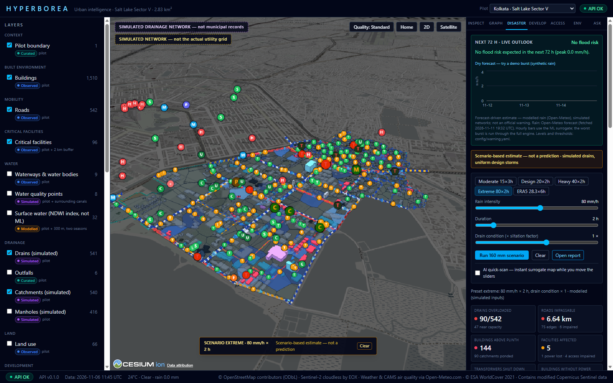
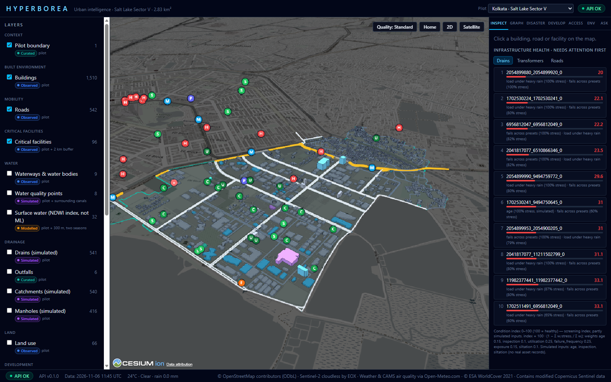
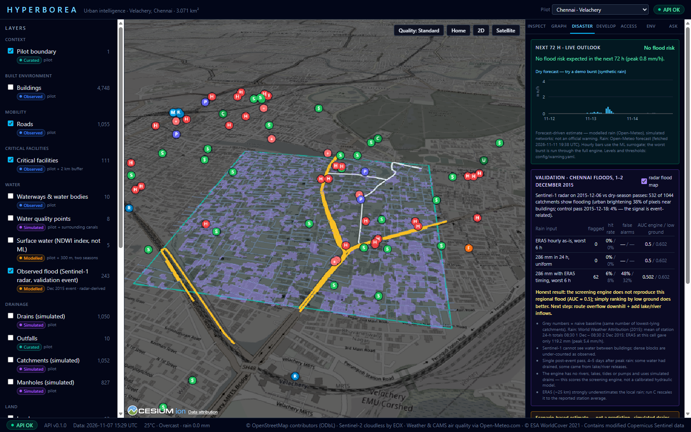
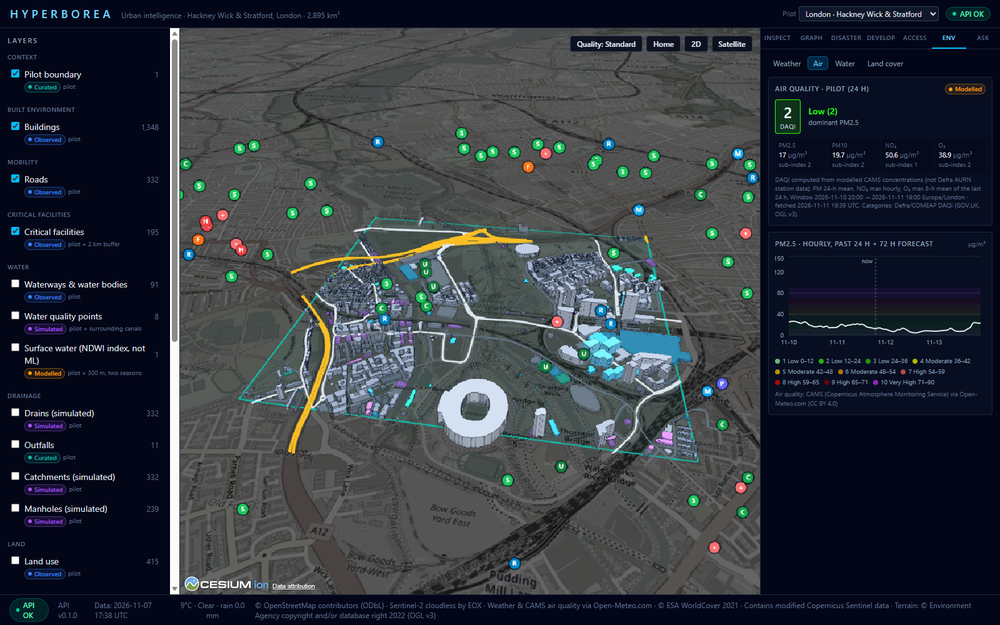
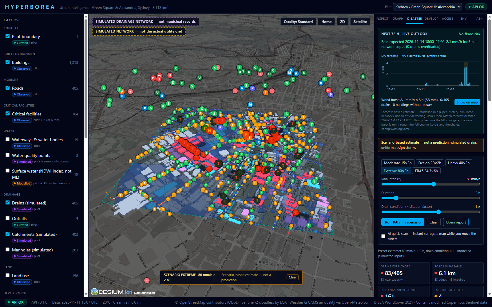
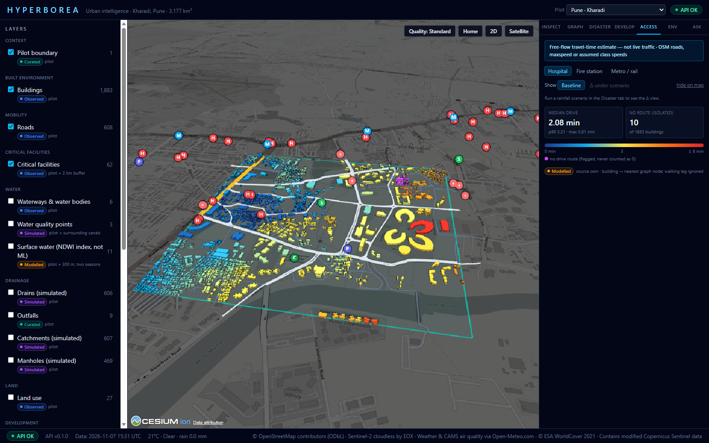
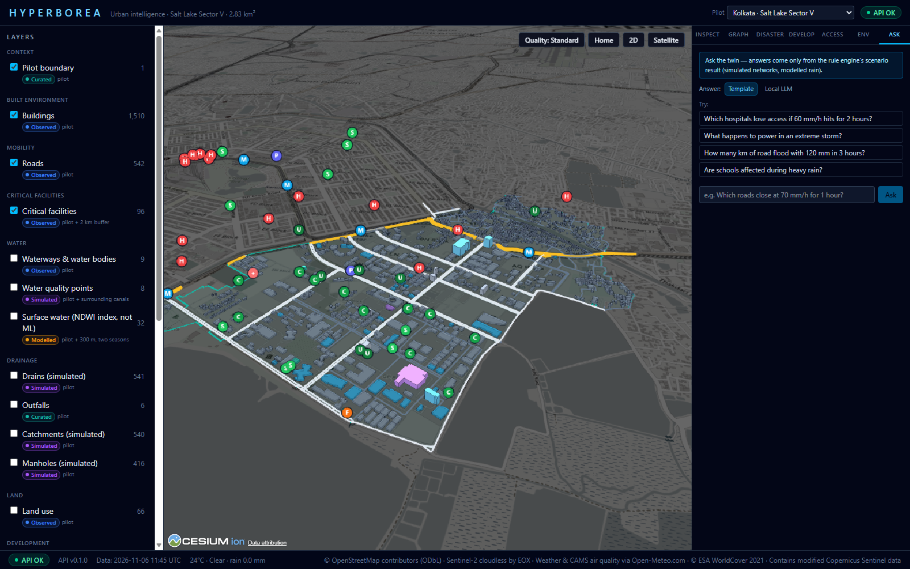

# Hyperborea — urban infrastructure digital twin

**FIRE 2026 · SustAI.** Cities run drainage, power, roads and emergency services in separate systems, so nobody sees how
a downpour in one street becomes a dark hospital or a blocked ambulance route two blocks away. Hyperborea puts five
~3 km² urban pilots into one 3D twin where every asset is linked in a typed dependency graph, and runs transparent
"what-if" scenarios on it — each result explained hop by hop.



> **Honest by design.** Every feature carries `data_status` (observed · curated · modelled · simulated) and a `source_id`.
> Drainage and electrical networks are **simulated** because no city publishes them — and the UI says so. Results are
> scenario estimates, not predictions; risk scores are indices, not probabilities. We validated the engine against a real
> flood and publish the (unflattering) result.

## What it does
| Module | What you get |
|---|---|
| **3D command centre** | CesiumJS map, extruded buildings, layer manager with provenance badges, inspector, floating info tags, 2D/3D |
| **Five pilots** | Kolkata (Salt Lake Sector V), Chennai (Velachery), Pune (Kharadi), London (Hackney Wick & Stratford), Sydney (Green Square) — one switch in the header |
| **Flood cascade** | rain → drain overload → ponding → impassable roads → buildings above plinth → transformer shutdown → facilities without power or access, with a **Why?** chain per asset |
| **Live early warning** | 72 h forecast → hourly ML quick-scan → worst burst run through the full engine → watch / warning banner |
| **Validation** | Chennai Dec 2015 flood seen by Sentinel-1 radar vs our engine: hit rate, false alarms, AUC vs a "lowest ground floods first" baseline |
| **Upgrade optimiser** | best drain upsizes, plinth raises and detention tanks for a budget (assumed unit costs in ₹ / £ / A$) |
| **Development screening** | pick or draw a site → drainage, flood, road, facilities, electrical, water, land-use checks → A/B/C comparison (never an "approval") |
| **Accessibility** | drive times to hospitals, fire stations and metro; flood-induced delays and isolated buildings |
| **Environment** | Open-Meteo weather, ERA5 rainfall record, CAMS air quality in the local index (India NAQI, UK DAQI, NSW categories), WorldCover land cover, NDVI, NDWI surface water |
| **Ask the twin** | plain-language questions answered only from engine results (rule parser, or a local LLM with a numeric grounding check) |
| **Reports & health** | infrastructure condition index, printable scenario report (PDF / JSON / CSV) |
| **Works offline** | if the API is unreachable the app serves frozen snapshots for every pilot |

## Screenshots
| | |
|---|---|
|  **Command centre** — Kolkata, provenance-labelled layers and the infrastructure health list |  **Flood cascade** — extreme storm, 90 of 542 drains overloaded, live 72 h outlook on top |
|  **Validation** — Chennai Dec 2015 radar flood map (violet) and the scorecard |  **London** — UK DAQI from CAMS, LiDAR terrain |
|  **Sydney** — extreme storm cascade in Green Square |  **Pune** — drive time to the nearest hospital per building |
|  **Ask the twin** — grounded question answering | |

## The pilots
| Pilot | Area | Buildings | Terrain | Air index | Extreme storm (80 mm/h × 2 h) |
|---|---|---|---|---|---|
| Kolkata · Salt Lake Sector V | 2.83 km² | 1,510 | Copernicus DEM 30 m | India NAQI | 90 / 542 drains overloaded · 6.6 km roads impassable |
| Chennai · Velachery | 3.07 km² | 4,748 | Copernicus DEM 30 m | India NAQI | 220 / 1,055 · 10.1 km |
| Pune · Kharadi | 3.18 km² | 1,883 | Copernicus DEM 30 m | India NAQI | 111 / 608 · 4.7 km |
| London · Hackney Wick & Stratford | 2.90 km² | 1,348 | EA LiDAR DTM 5 m | UK DAQI | 97 / 332 · 4.4 km |
| Sydney · Green Square & Alexandria | 3.12 km² | 1,318 | Copernicus DEM 30 m | NSW AQC | 83 / 405 · 6.1 km |

Buildings, roads and facilities are OpenStreetMap (observed); drains and transformers are simulated in every pilot.
Full breakdown: [docs/DATA.md](docs/DATA.md).

## Validation — what we learned
Chennai, 1–2 December 2015 (286 mm station average in 24 h). Sentinel-1 radar on 6 Dec shows flooding in 532 of 1,044
catchments: 38 % of pixels next to buildings brightened (water between walls), against 4 % on a control pass after the
water receded. With the reported rain, the engine flags 62 catchments — hit rate 6 %, false alarms 48 % — and ranks
catchments no better than chance (AUC 0.50), while simply ranking by low ground scores AUC 0.60. Cause: a regional flood
(lake releases, river overflow, marsh backwater) that a local-runoff screening engine does not model. Next step: route
overflow downhill and add lake/river inflows.

## Quick start (Windows / PowerShell)
```powershell
git lfs install
git clone https://github.com/soham-newjourney2/1.hyperborea.git hyperborea; cd hyperborea
.\scripts\setup.ps1            # .venv + Python packages, npm packages, LFS data, .env from the template
. .\scripts\env.ps1            # every new shell: caches inside the project, activates .venv
.\scripts\dev.ps1              # API :8000 + web :5173 (+ local LLM if installed)
```
Open <http://localhost:5173> — no login by default. Step-by-step guide, optional local LLM and data rebuilds:
[SETUP.md](SETUP.md).

## Architecture
React 19 + TypeScript + CesiumJS frontend ↔ FastAPI modular monolith (layer store, relationship graph, flood / power /
access / development engines, ML surrogate, warning, optimiser, validation, explainer) ↔ per-region GeoPackages built by
offline Python pipelines. Regions are pure configuration (`config/regions.yaml`). Details, diagram and API list:
[docs/ARCHITECTURE.md](docs/ARCHITECTURE.md).

| Layer | Stack |
|---|---|
| Frontend | React 19, TypeScript, Vite, CesiumJS (no ion), Tailwind 4, Zustand, Recharts, Cytoscape |
| Backend | Python 3.12, FastAPI, GeoPandas, Shapely, NetworkX, scikit-learn, PyJWT (optional login) |
| Pipelines | osmnx + pyosmium, rasterio / rioxarray, pystac-client + Planetary Computer, scipy |
| AI | scikit-learn flood surrogate (per region); optional local LLM Qwen3-4B-Instruct-2507 via Ollama (Apache-2.0 / MIT) |

## Configuration
| `.env` variable | Purpose |
|---|---|
| `AUTH_REQUIRED` | `false` (default): open access · `true`: admin login with `ADMIN_PASSWORD` + `JWT_SECRET` (≥ 32 chars) |
| `CORS_ORIGINS` | allowed browser origins |
| `EXPLAINER` | `template` (default) or `ollama` |
| `OLLAMA_URL`, `OLLAMA_MODEL` | local LLM endpoint and model |
| `VITE_API_URL` | frontend → API base URL |

Engine thresholds and assumptions are plain YAML in `config/` (flood, risk, scenarios, norms, warning, costs, air-quality
bands, regions).

## Tests and checks
```powershell
pytest backend/tests -q                                   # 138 tests: engines, endpoints, regions, add-ons
cd frontend; npm run lint; npm test; npm run build; cd ..  # oxlint, vitest, type-check + production build
python scripts/audit_data.py                              # provenance audit of all five pilots (must say PASS)
```

## Limitations
- Drainage and electrical networks are simulated; the flood engine is a rule-based screening model (rational method,
  Manning, local ponding capped at 1 m) without rivers, lakes, tides, pumps or calibration.
- Uniform design storms; travel times are free-flow; air quality is one modelled value per pilot; water-quality points
  are demo data; development norms are Indian defaults in every pilot.
- ERA5 (~25 km) smooths local cloudbursts; the ML surrogate imitates our engine, not real floods; the LLM can still slip
  in meaning (numbers are checked, meaning is not) — template answers are the default.

## Roadmap
Downhill overflow routing and lake/river inflows · real drain surveys and pumping stations for one city · utility
transformer data (UK Power Networks open data needs only an account) · rain-gauge feeds · live traffic · more validation
events (Sentinel-1 for Kolkata and Sydney floods) · city-specific planning norms.

## Data and attribution
© OpenStreetMap contributors (ODbL) · Copernicus DEM GLO-30 © DLR/Airbus, ESA · © Environment Agency 2022 (OGL v3) ·
ERA5 (Copernicus/ECMWF), weather and CAMS air quality via Open-Meteo.com (CC BY 4.0) · © ESA WorldCover 2021 (CC BY 4.0) ·
Contains modified Copernicus Sentinel data 2015–2026 · Sentinel-2 cloudless by EOX. Sources, licences and processing:
[docs/DATA.md](docs/DATA.md).

## Licence
Code: MIT (see [LICENSE](LICENSE)). Data keeps the licence of its source.
