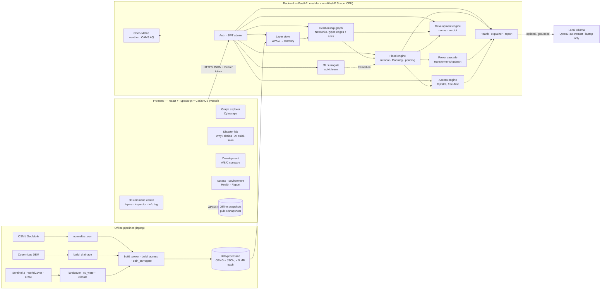

# Architecture

## Modules
| Layer | Module | Responsibility |
|---|---|---|
| API | `backend/app/api/*` | thin FastAPI routers (`/region`, `/layers`, `/assets`, `/graph/*`, `/scenarios/flood`, `/development/*`, `/environment/*`, `/access/summary`, `/ml/*`, `/infra-health`, `/explain`, `/report`, `/auth/login`) |
| Services | `layer_store`, `weather`, `air` | load all processed GeoPackages/GeoJSON into memory at startup; cached external data with stale fallback |
| Engine | `graph`, `relationships` | one typed MultiDiGraph; every edge has `rule`, `data_status`, `confidence` |
| Engine | `flood`, `hydraulics`, `rules` | scenario overlay (baseline never mutated): runoff → DAG routing → ponding → roads → buildings → transformers → facilities; risk index + explanation |
| Engine | `access`, `development`, `surrogate`, `health`, `explain` | travel times, development checks + verdict, ML quick-scan, condition index, grounded explanations |
| Pipelines | `pipelines/*` | offline data build (OSM, DEM, drainage, power, climate, land cover, NDWI, surrogate training) |
| Frontend | `frontend/src/*` | Cesium map with one look system (originals → scenario look → highlight), lazy panels, snapshot fallback |

## Data flow for one scenario
1. User picks a preset → `POST /scenarios/flood` (admin token).
2. Flood engine runs on a read-only `FloodContext` (drains, catchments, roads, buildings, transformers, graph edges).
3. Access engine re-routes with impassable roads removed; result is cached by params hash.
4. Response: per-layer states + affected assets ranked by risk index + an explanation object per asset.
5. Frontend recolours entities by id; **Why?** renders the explanation; the report page reads `/report/{result_id}`.

## Provenance model
Every feature: `asset_id · asset_type · name · data_status · source_id · observed_at · ingested_at · confidence ·
assumptions · attrs`. Every edge: `relationship_id · type · source · target · rule · weight · unit · data_status ·
confidence · assumptions`. `scripts/audit_data.py` enforces it ([DATA_AUDIT.md](DATA_AUDIT.md)).
