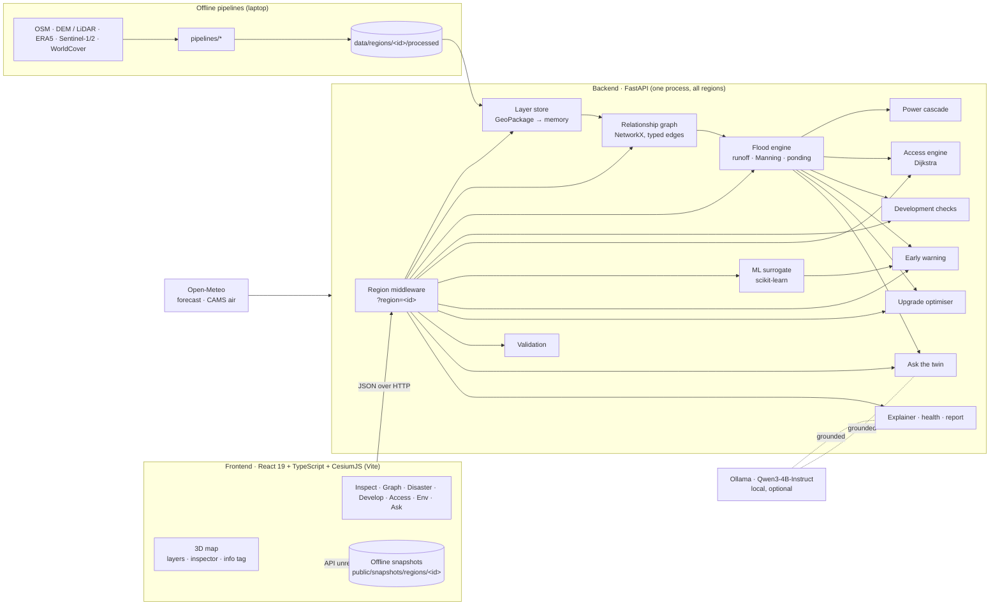

# Architecture

Hyperborea is a **modular monolith**: one FastAPI backend that holds every pilot region in memory, a React + CesiumJS
frontend, and offline Python pipelines that build each region's data. No database server, no message broker — data lives
in small GeoPackages / JSON files per region (`data/regions/<id>/`).

## Regions
`config/regions.yaml` is the only place a pilot is defined: id, name, curated study boundary, timezone, metric CRS (UTM
zone), air-quality index (`naqi` / `daqi` / `nsw_aqc`), design storm, OSM extract URL and per-region options (DEM source,
rainfall thresholds, Sentinel-2 windows). Five pilots ship today: `sector_v` (default), `chennai_velachery`,
`pune_kharadi`, `london_stratford`, `sydney_green_square`.

- **Request scope:** `core/region_middleware.py` reads `?region=` (default `sector_v`, unknown → 404) into a context
  variable. Every cached loader is decorated with `@per_region`, so a region's layers, graph, flood context, surrogate and
  caches are built once, lazily, and never mix with another region.
- **Paths:** only `core/regions.py` knows folders — `data_dir(kind)`, `local_dir(kind)`, `model_dir()`.
- **Pipelines** use the same registry through the `HYPERBOREA_REGION` environment variable.

## Backend modules
| Layer | Module | Responsibility |
|---|---|---|
| Core | `app/core/` | settings (`.env`), region registry + middleware, provenance enum, optional auth (`AUTH_REQUIRED`, off by default) |
| Services | `app/services/` | layer store (all processed GeoPackages + curated/synthetic GeoJSON → GeoDataFrames + pre-serialised GeoJSON), weather + air quality (Open-Meteo, cached, snapshot fallback; NAQI / DAQI / NSW AQC) |
| API | `app/api/` | thin routers, one per feature (see below) |
| Engine | `engine/graph.py`, `relationships.py` | one MultiDiGraph per region; every edge type has a written rule |
| Engine | `engine/flood.py`, `hydraulics.py`, `rules.py` | rainfall cascade on a scenario overlay (baseline never mutated) |
| Engine | `engine/access.py`, `development.py`, `health.py` | travel times, development screening, infrastructure condition index |
| Engine | `engine/surrogate.py` | ML quick-scan (HistGradientBoosting) trained on engine runs |
| Engine | `engine/warning.py`, `optimise.py`, `validation.py`, `ask.py`, `explain.py` | early warning, upgrade optimiser, validation metrics, question answering, grounded explanations |

## Flood engine (the core rule set)
For one scenario (uniform rain *i* mm/h for *t* h, drain condition scale):
1. **Runoff** per catchment — rational method `Q = C · i · A / 3.6e6` (C: roof 0.90, road 0.85, other 0.40).
2. **Routing** in topological order of `DRAINS_TO`; capacity = Manning full flow × condition factor; outflow = min(inflow, capacity).
3. **Ponding** — overflow volume spread over 30 % of the catchment, capped at 1.0 m.
4. **Roads** impaired ≥ 0.15 m, impassable ≥ 0.30 m · **buildings** exposed above a 0.45 m plinth.
5. **Power** — a transformer standing in water ≥ its plinth (0.6 m) shuts down; its buildings and facilities lose power.
6. **Facilities** — access cut when all access roads are impassable; power lost via their transformer.
7. **Access** — Dijkstra on the drive graph with impassable roads removed → extra minutes / isolated buildings.
8. **Risk index** (0–1, not a probability) and an **explanation chain** per affected asset (inputs, rule, formula, assumptions).

Scenario overlays (used by development, optimiser) change only the run: extra inflow, drain capacity, transformer plinth,
detention storage. Thresholds live in `config/flood.yaml`, `config/risk.yaml`.

## Add-on features
| Feature | How it works | Endpoint |
|---|---|---|
| Early warning | 72 h forecast → per-hour surrogate quick-scan → worst 1–3 h burst → full engine run → none / watch / warning (`config/warning.yaml`); labelled synthetic demo burst when dry | `GET /warning` |
| Validation | Sentinel-1 radar flood map (Chennai, Dec 2015) vs engine runs: hit rate, false alarms, CSI, AUC vs a lowest-ground baseline | `GET /validation` |
| Upgrade optimiser | Candidates from the scenario's failures (drain upsize, plinth raise, detention); lazy-greedy on risk removed per assumed unit cost (`config/costs.yaml`) | `POST /optimise` |
| Ask the twin | Rule parser (or local LLM with a JSON schema) → scenario → facts → template answer, or LLM answer that passes the numeric grounding check | `POST /ask` |

## API (prefix `/api`, optional `?region=<id>`)
| Method & path | Purpose |
|---|---|
| `GET /health` · `GET /regions` | status (+ `auth_required`), pilot registry |
| `GET /region` · `/layers` · `/layers/{id}` · `/assets/{id}` | boundary, layer list, GeoJSON, asset detail + relationships |
| `GET /weather/current` · `/weather/forecast` · `/climate/summary` · `/scenarios/presets` | Open-Meteo forecast, ERA5 record, rainfall presets |
| `GET /graph/summary` · `/graph/neighbors/{id}` · `/graph/path` · `/graph/trace/{drain}` | relationship explorer |
| `POST /scenarios/flood` | rainfall cascade result |
| `POST /development/assess` · `/development/compare` | site screening + A/B/C comparison |
| `GET /environment/air` · `/environment/water` · `/environment/landcover` | air index, water points, land cover + NDVI |
| `GET /access/summary` | travel times (baseline or scenario) |
| `GET /ml/quickscan` · `/models` | surrogate map, model cards |
| `GET /infra-health` · `POST /explain` · `GET /report/{id}` | condition index, explanation, report data |
| `GET /warning` · `GET /validation` · `POST /optimise` · `POST /ask` | add-ons |
| `POST /auth/login` | only used when `AUTH_REQUIRED=true` |

## Frontend
`frontend/src/App.tsx` (shell, tabs, deep links `?region=&tab=&scenario=&layers=`), `components/MapView.tsx` (Cesium
viewer, one styling switch per layer, scenario colouring by asset id), one component per tab/card, `lib/api.ts` (typed
client; every call carries `?region=`; falls back to `public/snapshots/regions/<id>/*.json` when the API is unreachable),
`lib/region.ts` (active pilot from the URL; switching reloads the app), `store.ts` (Zustand).

## Offline pipelines
`scripts/build_region.ps1 -Region <id>` runs, in order: boundary → `fetch_osm` → `normalize_osm` → `fetch_dem` →
`build_drainage` → `build_power` → `make_water_demo` → `landcover` → `cv_water` → `build_access` → `climate` →
`make_sites` → `train_surrogate`. `validate_flood` scores an observed event (Chennai). `scripts/make_snapshots.py`
freezes API responses per region; `scripts/audit_data.py` checks provenance on every layer.

## Quality gates
`pytest backend/tests` (engines, endpoints, regions, auth switch, add-ons) · `npm run lint && npm test && npm run build` ·
`python scripts/audit_data.py` (every feature has `asset_id`, valid `data_status`, registered `source_id`; simulated layers
flagged; no non-LFS file > 5 MB; no secrets tracked).
